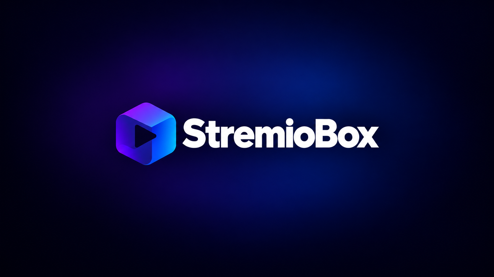
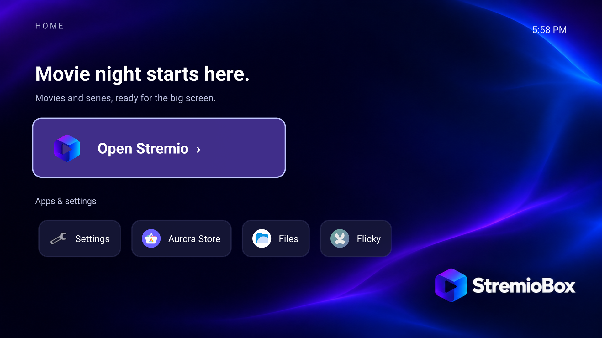

# StremioBox

**Android 16 voor een Intel NUC met Stremio op je tv.**

[Download](https://github.com/zubSero/StremioBox/releases/tag/r8) · [Installatie](docs/installation.md) · [Changelog](CHANGELOG.md) · [Website](https://zubsero.github.io/StremioBox/) · [English](README.md)

StremioBox is een opstartbaar Android TV-image op basis van Android 16 / LineageOS 23.2. Het bevat een startscherm voor bediening met een afstandsbediening, Stremio TV 1.10.4 en fixes voor Intel-video, HDMI-audio, Bluetooth en ondertitels. De gewone mpv-interface van Stremio, inclusief de afspeelbalk, blijft beschikbaar.

**Deze preview is getest op één configuratie:** Intel NUC10i5FNH, Intel UHD-graphics, Intel AX201 Bluetooth, Homatics B21 en een LG HDR-tv. Andere hardware vraagt aparte tests. Langdurige afspeeltests en de schijfinstaller zijn nog niet gevalideerd; probeer eerst live boot vanaf USB.

## Wat is getest?

| Onderdeel | Resultaat | Beperking |
| --- | --- | --- |
| 4K HEVC Main10 HDR10 | Hardwaredecodering, goede kleuren en HDR-modus op de tv | Korte tests rond 24 fps; geen bevestiging voor 4K60 of andere HDR-formaten |
| HDMI-audio | Hoorbaar geluid voor en na display-standby; 5.1 gaat als Dolby Digital naar buiten en een optische soundbar achter de tv speelt echte 5.1 | Receivers die meerkanaals-PCM via HDMI aannemen krijgen ook AC-3; stereobronnen blijven op de voorste speakers |
| Homatics B21 | Gewone toetsen werken na reboot zonder opnieuw koppelen | Fysieke powerknop verdient nog een aparte hertest |
| Display-standby | Beeld, geluid en bediening keren terug na Android-slaap/wekcommando's | Vastloper na lange standby opgelost in r7; fysieke nachttest volgt; echte S3-slaap niet getest |
| Ondertitels | Disabled en taal-/audiowissels gecontroleerd met externe SRT | Niet ieder formaat of iedere stream getest |
| Startscherm | Engelse Home 1.1, ook na reboot | Eigen launcher; Android en Stremio hebben hun eigen taalinstellingen |
| Appwinkels | Aurora Store en Flicky openen vanuit Home en blijven na reboot | Volledige appinstallatie via elke winkel nog te testen; geen Google Play-diensten |

[Hardwarematrix](docs/hardware.md) · [Testresultaten](docs/testing.md)

## Nieuw in deze uitgave — 5.1 Surround Sound

- **Echte 5.1 via de tv, verstaanbare dialoog.** Het geluid verlaat de NUC nu als Dolby Digital 5.1. Een soundbar of surroundsysteem op de optische uitgang van de tv decodeert het met de dialoog op de centerspeaker, in plaats van een stereomix waarin stemmen verdronken. Zet de digitale audio-uitgang van de tv op Auto of Passthrough. [Werking (Engels)](platform/next/audio-ac3/README.md)
- **De sync-optie werkt.** Audio- of ondertitelsync aanpassen in de Stremio-speler laat het beeld niet meer vastlopen.

Eerdere uitgaven brachten de standby-fix, Aurora Store en Flicky, een rustige standby en een optioneel [noodsysteem](docs/rescue.md); die blijven allemaal aanwezig. De fysieke NUC draait de gewijzigde audiobestanden vanuit zijn ontwikkelinstallatie, maar is niet opnieuw geïnstalleerd met de nieuwe ISO. [Testgrenzen](docs/testing.md#surround-sound-release)

## Downloaden

De huidige uitgave heet **Intel NUC Preview — 5.1 Surround Sound**. Deze bevat alle eerdere fixes, het Engelse startscherm, de standby-fix, beide appwinkels en 5.1-uitvoer. De [uitgebreide changelog](CHANGELOG.md) beschrijft elke wijziging en de bijbehorende tests.

1. Download en pak de [downloadhulp](https://github.com/zubSero/StremioBox/releases/download/r8/StremioBox-r8-native-download.zip) uit.
2. **Windows:** dubbelklik op `Download-StremioBox.cmd`. **Linux/macOS:** open een terminal in de uitgepakte map en voer `bash tools/download.sh --output downloads` uit. Python is niet nodig.
3. Reserveer ongeveer 6 GB vrije ruimte. De hulp downloadt twee delen en controleert de hashes van de delen en de samengestelde ISO.
4. Volg de [installatiegids](docs/installation.md), probeer live boot en koppel daarna je eigen remote en Stremio-account.

Draai je al r5, r6 of r7? De 5.1-uitvoer en de sync-fix vervangen systeembestanden en vragen een herinstallatie met r8; op r5/r6 kun je de winkels ook via ADB toevoegen. [Updatemogelijkheden](docs/installation.md#update-an-existing-installation).

Heb je de eerste image met Nederlands Home al geïnstalleerd? De [losse Engelse Home-update](docs/installation.md#update-an-existing-installation) gebruikt dezelfde ondertekening en blijft na reboot actief. De technische downloadcode van deze uitgave is `r8`.

## Grenzen van deze preview

Dolby Vision, HLG, AV1, VLC/ExoPlayer, 4K60, HDMI-CEC, echte S3-slaap en andere GPU's zijn nog niet bevestigd. De ontwikkelbuild gebruikt permissieve SELinux en geauthenticeerde ADB op poort 5555; gebruik een vertrouwd netwerk. Het gedeelde image bevat geen persoonlijke accounts, privésleutels of Bluetooth-koppelingen.

De verpakte fixes blijven na reboot actief. Nieuwe Stremio-versies moeten opnieuw op compatibiliteit worden gecontroleerd. Er is geen automatisch OS-updatekanaal. Elke uitgave na de eerste is gemaakt met een vastgelegde, gecontroleerde wijziging van het vorige image; een volledige Android-build vanuit deze publieke repository staat nog open.

**Pull requests zijn welkom.** Iedereen kan het project forken en fixes, hardwareverbeteringen, vertalingen of documentatie insturen. Je kunt meteen een PR openen; wijzigingen worden bekeken voordat ze worden samengevoegd. [Zo draag je bij](CONTRIBUTING.md).

[Problemen oplossen](docs/troubleshooting.md) · [Noodsysteem](docs/rescue.md) · [Broncode bouwen](docs/building.md) · [Roadmap](docs/roadmap.md) · [Probleem melden](https://github.com/zubSero/StremioBox/issues/new/choose)

StremioBox is een onafhankelijk communityproject, zonder officiële band met Stremio of LineageOS. [Licenties en credits](THIRD_PARTY_NOTICES.md).
