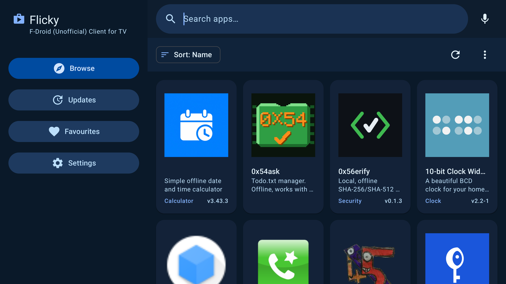

# Standby recovery and installing other apps

[Project](../README.md) · [Candidate sources](../platform/next/README.md) · [Testing](testing.md) · [Rescue system](rescue.md)

**Status: 2026-10-14.** These changes are included in **Intel NUC Preview — Standby & App Stores** (`r7`). The r7 image is a verified repack of r6 with exactly five changed system entries: the fixed SurfaceFlinger, the updated first-boot script, the two store APKs and an empty fingerprint feature file. Kernel, initrd, recovery, Home and every other system entry keep their r6 bytes. [Image delta](../releases/r7-image-delta.json) · [Change specification](../releases/r7-changes.json).

The fixed SurfaceFlinger is the exact-build binary that was validated on the development NUC (SHA-256 `9018b309…c780`), not a fresh compile of patch 0018. A full source build remains on the [roadmap](roadmap.md).

## Standby hang after hours or overnight

The NUC10i5FNH sometimes stayed powered on while the TV reported **No signal**. The Homatics power button and a USB keyboard could not restore output, and ADB became unavailable. A cold power cycle restored normal operation. Failure to reconnect the remote during this state does not establish that its Bluetooth bond was deleted.

Captured watchdog traces identified SurfaceFlinger blocked during ConsoleManagerThread destruction. The earlier console-thread exit fix did not cover the subsequent virtual-terminal restore: VT_WAITACTIVE could wait indefinitely after the thread responsible for acknowledging VT_PROCESS transitions had exited.

Patch 0018 switches the terminal back to VT_AUTO before VT_ACTIVATE, then polls VT_GETSTATE at most 20 times with 10 ms delays. It preserves the existing constructor's VT_PROCESS behavior and the remaining terminal cleanup. The intended power mode remains display standby with Android running; this does not add S3 suspend support.

On the development device, an exact-build native hotfix implements the same destructor change. r7 ships that same binary directly in the system image, with the original file's mode, owner and SELinux label. Low Power Standby was also disabled on the development device to retain network access during the intended display-only standby; that setting is not yet a universal image policy.

## Console log spam during standby

On the development NUC the TV sometimes showed scrolling kernel text instead of a black screen during standby, which looked like a boot loop. Android was not restarting: the vendor partition declared `android.hardware.fingerprint`, so BiometricService looked for a fingerprint HAL that does not exist and logged an error every second to the console. r7 replaces that vendor feature file with an empty permissions file. Android no longer reports a fingerprint feature and the errors stop. The NUC has no fingerprint sensor, so no functionality is lost.

| Check | Result |
| --- | --- |
| Two full reboots (development NUC) | Correct hotfix and store-seed payloads active after boot |
| Three Android sleep/wake cycles (development NUC) | Android and ADB responsive; compositor remained alive |
| Two DRM connector off/detect cycles (development NUC) | Output reconnected; four console-manager destructor calls completed |
| ANR count (development NUC) | No new ANRs during these checks |
| r7 ISO, fresh-data UEFI boot in QEMU/KVM | Boot completed; fixed SurfaceFlinger, Stremio, Flicky and Aurora Store hashes confirmed; no fingerprint feature |
| r7 ISO, three virtual sleep/wake cycles | SurfaceFlinger kept the same process ID; no ANRs; no IVirtualHal errors |
| Hours or overnight with physical Homatics power button | Pending |
| r7 ISO flashed to the physical NUC | Pending; the NUC runs the same files through its development installation |
| Full source compilation | Pending |

If an r5/r6 installation hangs, first check the TV input and HDMI connection. Try waking Android with the remote or USB keyboard. If neither restores output, a cold power cycle recovered the test NUC. A new r7 installation includes the fix; an existing r5/r6 installation needs a reinstall with r7, because there is no portable system updater yet. Record elapsed standby time and whether ADB responds; do not repeatedly unpair the remote to diagnose an unresponsive system. Include redacted logs and hardware details in a bug report.

## Other apps, with Stremio kept prominent

Home already supports other installed apps in the secondary **Apps & settings** row. Android's package installer is available. The Android 16 image does not contain Google Play Store or Google Play services.

r7 adds two optional stores, installed once on first boot:

| Store | Pinned version | Role |
| --- | --- | --- |
| Flicky (`app.flicky`) | 4.5.4 / 988, x86_64 | TV-oriented client for F-Droid apps |
| Aurora Store (`com.aurora.store`) | 4.8.4 / 76 | Access to apps distributed through Google Play |

Press Home, move to **Apps & settings**, and open a store. Complete its own first-use setup and choose an app suitable for Android TV and x86_64. Aurora onboarding has been opened but no account or terms were accepted during development testing. Flicky's browse screen and catalogue loaded. Installing an app through each store's complete user flow still needs verification.

Newly seeded stores receive permission to request app installations; Android still handles installation. Existing store packages retain their state and permissions. The one-time marker prevents reseeding after the user removes a store, and the script does not replace user updates or clear app data. The original signed Stremio app and its primary Home action remain intact.

These stores do not supply Google Play services, device certification or subscription-service DRM. Apps requiring those components may not work. Phone-oriented apps may need a mouse or keyboard. Installing other apps is supported by the launcher; compatibility depends on each app.

APK/source URLs, sizes, hashes, ABIs and GPL-3.0-or-later provenance are pinned in [candidate inputs](../platform/next/inputs.json). Both APKs were verified against official F-Droid repository metadata before installation. Their corresponding source archives are attached to the [r7 release](https://github.com/zubSero/StremioBox/releases/tag/r7). See the [candidate build instructions](building.md#next-release-candidate) to include them in a source build.

### Remove a store you do not want

Open **Settings → Apps**, choose the store and select **Uninstall**. The one-time marker in `/data/local/stremiobox` keeps it from coming back after a reboot. To add it again later, install the APK from the release page with ADB.
